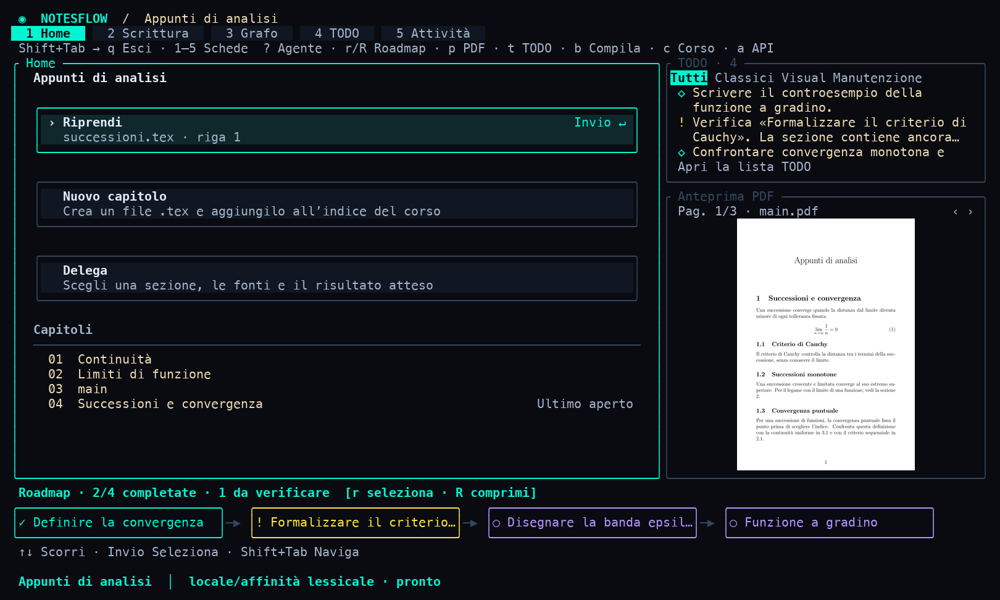

# Notesflow

Scrivi appunti LaTeX, controlla il PDF e segui i collegamenti tra i concetti dalla stessa sessione nel terminale. La home riunisce azioni, TODO, anteprima e roadmap. Il grafo e l’editor si aprono nella stessa interfaccia.

## Installa e prova

Su macOS con Homebrew:

```sh
brew install go neovim poppler gh
gh repo clone AndreaUnali/notesflow
cd notesflow
go build -o notesflow ./cmd/notesflow
./notesflow tui --workspace examples/workspace/analisi
```

Accedi con `gh auth login` se GitHub CLI lo richiede. Se ti manca `latexmk`, puoi installare MacTeX con `brew install --cask mactex-no-gui` e riaprire il terminale. Premi **b** per compilare l’esempio e popolare l’anteprima. Ghostty e Kitty mostrano il grafo e le pagine PDF a risoluzione grafica. Negli altri terminali puoi leggere il testo del PDF e navigare i collegamenti dalla lista del grafo.



## Il primo giro

1. Apri la cartella di un corso con `./notesflow tui --workspace /percorso/del/corso`. Se sei già nella cartella, avvia `notesflow` dal PATH.
2. Premi **2** per scrivere. I TODO si richiudono e il PDF occupa la colonna destra. Salva con **:w** e compila con **Shift+Tab**, poi **b**.
3. Premi **Shift+Tab**, poi **3**, per passare al grafo senza chiudere il buffer. La panoramica mostra i capitoli, fino a quattro concetti per capitolo e i loro legami principali. Selezionane uno con **↑/↓** e premi **Invio** per entrare, oppure fai doppio clic. Usa **Esc** per tornare alla panoramica e **/** per trovare una sezione specifica.
4. Premi **4** per rivedere le note con `% TODO:` e `% TODO VISUAL:`. **s** genera un riepilogo. La roadmap in basso legge le caselle di `roadmap.md`.


### Comandi

| Tasto | Azione |
| --- | --- |
| **1–5** | Home, scrittura, grafo, TODO, attività. Le schede si possono anche cliccare. |
| **Shift+Tab** | Porta il focus alle schede dall’editor o da un pannello. Usa **1–5** o **←/→** e **Invio**. **Tab** torna al pannello. |
| **r** / **R** | Seleziona le tappe / mostra o comprimi la roadmap. |
| **t** | Seleziona il riquadro TODO. **←/→** passa fra Tutti, Classici, Visual e Manutenzione. |
| **p** | Seleziona il PDF. **←/→** cambia pagina e **t** alterna pagina e testo. |
| **b** / **c** / **q** | Compila / cambia corso / esci. |

## Roadmap e verifiche

Crea `roadmap.md` nella cartella del corso. Notesflow usa le checkbox oppure, in una roadmap senza checkbox, i titoli numerati come `### 2.1 Virtualizzazione`. La barra si aggiorna quando salvi gli appunti. I titoli e il testo delle sezioni forniscono l’evidenza, anche quando roadmap e appunti usano terminologia tecnica in italiano e in inglese. Per indicare esattamente quale sezione verificare, aggiungi un link `[verifica]` al relativo file e alla sua etichetta LaTeX o intestazione Markdown.

```markdown
- [ ] Definire la convergenza [verifica](successioni.tex#sec:successioni)
- [ ] Formalizzare il criterio di Cauchy
```

Una casella `[x]` negli appunti Markdown o un commento LaTeX `% DONE:` con la stessa descrizione conferma la tappa. Le corrispondenze dubbie vengono completate nella barra con un **!** e aggiungono un **TODO Manutenzione** con il motivo, il file e la riga degli appunti.

Premi **r** per selezionare la tappa, **e** per aprire l’evidenza negli appunti o **Invio** per aprire la roadmap. Conferma con `[x]` oppure aggiungi `<!-- notesflow: pending -->` in coda alla tappa per tenerla aperta. Notesflow aggiorna lo stato nella TUI al salvataggio.

## Esplora il grafo

La panoramica mostra i concetti principali di ogni capitolo, i riferimenti LaTeX e una selezione dei collegamenti più forti. Apri un capitolo per vedere le altre sezioni. Usa **Pg↑/Pg↓** se un capitolo occupa più pagine e **Invio** per aprire la riga sorgente. La ricerca trova anche le intestazioni minute.

Ogni concetto ha fino a tre relazioni semantiche. La panoramica ne mostra una selezione, e nel dettaglio puoi vedere quelle del nodo selezionato o sotto il puntatore. I legami locali si basano sul lessico distintivo dei titoli e degli appunti. La gerarchia e i riferimenti LaTeX restano consultabili anche senza un provider AI.

## Usa i tuoi appunti

Il flusso locale funziona subito con un documento principale come `main.tex`. Se usi altri nomi o cartelle di output, copia [notesflow.example.json](notesflow.example.json) come `notesflow.json` nella cartella del corso e indica `tools.main_tex` o `tools.pdf`.

Per un riepilogo o collegamenti semantici con un LLM, attiva il tuo profilo nella configurazione. La demo usa affinità lessicali locali e funziona senza chiavi. Se hai OpenCode nel PATH, puoi anche avviarlo dalla home del corso.

Per la vista Canvas nel browser usa `notesflow serve --workspace /percorso/del/corso --open`. Per compilazione, export di diagrammi Mermaid/Pikchr e altre operazioni da shell usa `notesflow --help`.
