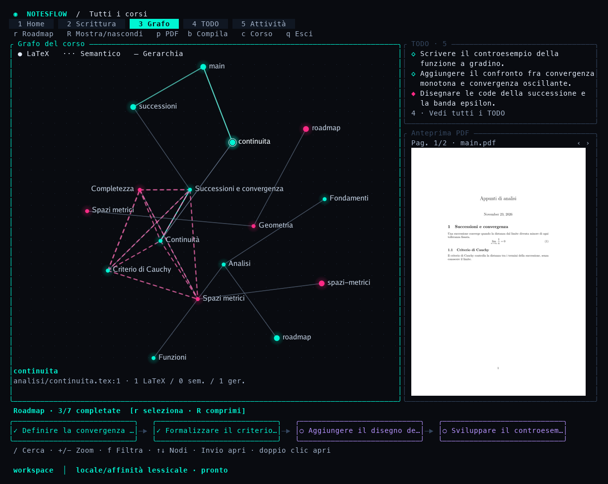

# Notesflow

Scrivi appunti LaTeX, controlla il PDF e segui i collegamenti tra i concetti dalla stessa sessione nel terminale. La home riunisce azioni, TODO, anteprima e roadmap. Il grafo e l’editor si aprono nella stessa interfaccia.

## Installa e prova

Su macOS con Homebrew:

```sh
brew install go neovim poppler gh
gh repo clone AndreaUnali/notesflow
cd notesflow
go build -o notesflow ./cmd/notesflow
./notesflow tui --workspace examples/workspace/analisi
```

Accedi con `gh auth login` se GitHub CLI lo richiede. Se ti manca `latexmk`, puoi installare MacTeX con `brew install --cask mactex-no-gui` e riaprire il terminale. Premi **b** per compilare l’esempio e popolare l’anteprima. Ghostty e Kitty mostrano il grafo e le pagine PDF a risoluzione grafica. Negli altri terminali puoi leggere il testo del PDF e navigare i collegamenti dalla lista del grafo.


## Il primo giro

1. Apri la cartella di un corso con `./notesflow tui --workspace /percorso/del/corso`. Se sei già nella cartella, avvia `notesflow` dal PATH.
2. Premi **2** per scrivere. I TODO si richiudono e il PDF occupa la colonna destra. Salva con **:w** e compila con **Ctrl+G**, poi **b**.
3. Premi **Ctrl+G**, poi **3**, per passare al grafo senza chiudere il buffer. Cerca con **/**, usa la rotella per lo zoom e fai doppio clic su un nodo per aprirlo alla riga sorgente. Da tastiera usa **↑/↓** e **Invio**.
4. Premi **4** per rivedere le note con `% TODO:` e `% TODO VISUAL:`. **s** genera un riepilogo. La roadmap in basso legge le caselle di `roadmap.md`.




### Comandi

| Tasto | Azione |
| --- | --- |
| **1–5** | Home, scrittura, grafo, TODO, attività. Le schede si possono anche cliccare. |
| **Ctrl+G**, poi un comando | Usa le scorciatoie di Notesflow mentre scrivi o mentre un pannello ha il focus. |
| **r** / **R** | Seleziona le tappe / mostra o comprimi la roadmap. |
| **p** | Seleziona il PDF. **←/→** cambia pagina e **t** alterna pagina e testo. |
| **b** / **c** / **q** | Compila / cambia corso / esci. |

## Usa i tuoi appunti

Il flusso locale funziona subito con un documento principale come `main.tex`. Se usi altri nomi o cartelle di output, copia [notesflow.example.json](notesflow.example.json) come `notesflow.json` nella cartella del corso e indica `tools.main_tex` o `tools.pdf`.

Per un riepilogo o collegamenti semantici con un LLM, attiva il tuo profilo nella configurazione. La demo usa affinità lessicali locali e funziona senza chiavi. Se hai OpenCode nel PATH, puoi anche avviarlo dalla home del corso.

Per la vista Canvas nel browser usa `notesflow serve --workspace /percorso/del/corso --open`. Per compilazione, export di diagrammi Mermaid/Pikchr e altre operazioni da shell usa `notesflow --help`.
