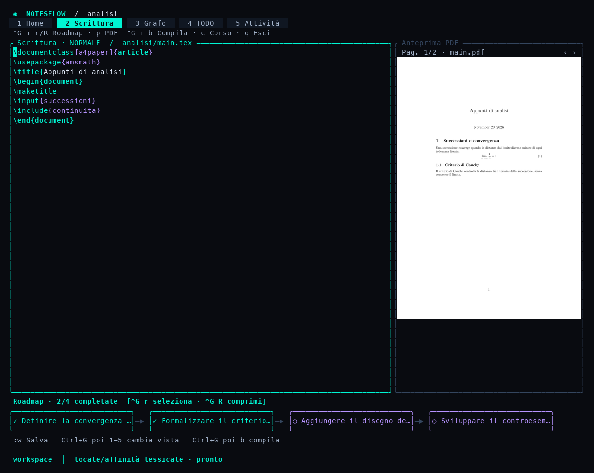

<h1 align="center">
  
</h1>

Scrivi appunti LaTeX, controlla il PDF e segui i collegamenti tra i concetti dalla stessa sessione nel terminale. La home riunisce azioni, TODO, anteprima e roadmap. Il grafo e l’editor si aprono nella stessa interfaccia.

## Installa e prova

### Homebrew

```sh
brew install AndreaUnali/notesflow/notesflow
```

### Debian e Ubuntu

Scarica e installa il [pacchetto della release](https://github.com/AndreaUnali/notesflow/releases/latest) con APT. Sono disponibili build per amd64 e arm64.

```sh
curl -fL -o notesflow.deb "https://github.com/AndreaUnali/notesflow/releases/latest/download/notesflow-linux-$(dpkg --print-architecture).deb" && sudo apt install ./notesflow.deb
```

### Apri Notesflow

```sh
notesflow
notesflow --workspace /percorso/del/corso
```

Il primo comando apre il selettore dei progetti da qualsiasi cartella. Il secondo apre direttamente il corso. L’installazione include Neovim e Poppler per scrivere e vedere i PDF.

Per compilare LaTeX serve anche `latexmk`. Su macOS puoi installarlo con `brew install --cask mactex-no-gui` e riaprire il terminale. Su Debian e Ubuntu puoi usare `sudo apt install latexmk texlive-latex-extra`. In Notesflow premi **Shift+Tab**, poi **b**, per compilare e aggiornare l’anteprima. Ghostty e Kitty mostrano grafo e PDF a risoluzione grafica.

Per aggiornare con Homebrew usa `brew upgrade AndreaUnali/notesflow/notesflow`. Su Debian e Ubuntu ripeti il comando di installazione per scaricare il pacchetto più recente.

<details>
<summary>Compila dal sorgente e prova il corso di esempio</summary>

```sh
git clone https://github.com/AndreaUnali/notesflow.git
cd notesflow
go run ./cmd/notesflow --workspace examples/workspace/analisi
```

</details>

## Il primo giro

1. Avvia `notesflow` e scrivi il nome di una **Note Network**. La ricerca include i recenti e i progetti LaTeX in Scrivania, Documenti e nella cartella corrente. Premi **Ctrl+O** per aggiungere una cartella esistente, oppure incolla il percorso nella ricerca. Se hai già un progetto in mente, usa `notesflow --workspace /percorso/del/corso`.
2. In Home, **Riprendi** riapre file e cursore dell’ultima sessione. **Nuovo capitolo** propone il file e il punto in cui includerlo nel documento principale. TODO, PDF e roadmap sono visibili dalla Home.
3. Premi **Shift+Tab**, poi **2**, per scrivere. Il PDF occupa la colonna destra. Salva con **:w** e compila con **Shift+Tab**, poi **b**.
4. Premi **Shift+Tab**, poi **3**, per esplorare il grafo con il buffer aperto. Usa **↑/↓** e **Invio** per aprire un nodo, **Esc** per tornare alla panoramica e **/** per cercare una sezione.




## Navigare e uscire

Premi **Shift+Tab** per raggiungere la barra di navigazione da qualunque vista, anche mentre scrivi in Neovim, cerchi nel grafo o compili un modulo. I tasti qui sotto si premono dopo aver attivato la barra.

| Tasto | Azione |
| --- | --- |
| **1–5** | Apri Home, Scrittura, Grafo, TODO o Attività. Puoi anche scegliere con **←/→** e confermare con **Invio**. |
| **Tab** o **Esc** | Torna al pannello o al campo da cui sei partito. |
| **q** | Esci da Notesflow. |
| **r** / **R** | Seleziona una tappa o espandi e comprimi la roadmap. Quando è compressa, condivide la barra in basso con scorciatoie, messaggi e stato. |
| **t** | Seleziona i TODO. **←/→** passa fra Tutti, Classici, Visual e Manutenzione. |
| **p** | Seleziona il PDF. **←/→** cambia pagina e **t** alterna pagina e testo. |
| **b** / **c** / **?** | Compila il PDF, cambia corso o chiedi all’agente. |

Per chiudere una sessione, usa **Shift+Tab**, poi **q**. Puoi anche cliccare **q Esci**. Se Neovim ha modifiche non salvate, Notesflow lascia aperta la sessione e ti riporta alla barra. Premi **2** per tornare in Scrittura. Chiudi un eventuale modulo con **Esc** e premi **Esc** in Neovim per tornare alla modalità normale. Salva tutti i buffer con **:wall**, poi ripeti **Shift+Tab → q**.

## Roadmap e verifiche

Crea `roadmap.md` nella cartella del corso. Notesflow usa le checkbox oppure, in una roadmap senza checkbox, i titoli numerati come `### 2.1 Virtualizzazione`. La barra si aggiorna quando salvi gli appunti. I titoli e il testo delle sezioni forniscono l’evidenza, anche quando roadmap e appunti usano terminologia tecnica in italiano e in inglese. Per indicare esattamente quale sezione verificare, aggiungi un link `[verifica]` al relativo file e alla sua etichetta LaTeX o intestazione Markdown.

```markdown
- [ ] Definire la convergenza [verifica](successioni.tex#sec:successioni)
- [ ] Formalizzare il criterio di Cauchy
```

Una casella `[x]` negli appunti Markdown o un commento LaTeX `% DONE:` con la stessa descrizione conferma la tappa. Le corrispondenze dubbie vengono completate nella barra con un **!** e aggiungono un **TODO Manutenzione** con il motivo, il file e la riga degli appunti.

Premi **Shift+Tab**, poi **r**, per selezionare la tappa, **e** per aprire l’evidenza negli appunti o **Invio** per aprire la roadmap. Conferma con `[x]` oppure aggiungi `<!-- notesflow: pending -->` in coda alla tappa per tenerla aperta. Notesflow aggiorna lo stato nella TUI al salvataggio.

## Esplora il grafo

La panoramica mostra i concetti principali di ogni capitolo, i riferimenti LaTeX e una selezione dei collegamenti più forti. Apri un capitolo per vedere le altre sezioni. Usa **Pg↑/Pg↓** se un capitolo occupa più pagine e **Invio** per aprire la riga sorgente. La ricerca trova anche le intestazioni minute.

Ogni concetto ha fino a tre relazioni semantiche. La panoramica ne mostra una selezione, e nel dettaglio puoi vedere quelle del nodo selezionato o sotto il puntatore. I legami locali si basano sul lessico distintivo dei titoli e degli appunti. La gerarchia e i riferimenti LaTeX restano consultabili anche senza un provider AI.

## Lavora con l’agente

Configura un profilo LLM in [notesflow.example.json](notesflow.example.json), oppure installa e configura OpenCode nel tuo terminale. Quando il profilo è quello locale, Notesflow usa l’OpenCode già configurato per **Chiedi** e **Delega**. Grafo, TODO e compilazione funzionano anche senza un modello remoto.

- Da **Scrittura**, premi **Shift+Tab**, poi **?**. Chiedi un aiuto sulla sezione corrente, su una formula o sull’ultima compilazione. La risposta è in **Attività**. Usa **f** per continuare o **w** per chiedere di applicare la proposta.
- Da **Home**, seleziona **Delega**. Scegli un file o una sezione con **←/→**, inserisci la richiesta e premi **Tab** per scegliere le fonti. Usa **Invio** per aggiungere il risultato evidenziato o digita un intervallo come `slide.pdf:12-14`. **Ctrl+S** invia.
- L’agente riceve il testo della destinazione e le fonti selezionate. Il risultato si applica quando il blocco assegnato è ancora quello di partenza. Se stai scrivendo altrove nello stesso buffer, salvi tutto insieme con **:w**. In caso di conflitto apri **Attività** per confrontare proposta e appunti.
- Quando l’agente ha una domanda appare una notifica in alto a destra. Cliccala o premi **Shift+Tab**, poi **5**, per scegliere. Dopo 90 secondi si applica la scelta consigliata e compare un **TODO Manutenzione**. Puoi cambiare il tempo con `agent.question_seconds`. **Spazio** mette in pausa o riprende una delega, **s** aggiunge una fonte e **f** invia un messaggio.
- Le figure suggerite compaiono come **TODO Visual** con il riferimento alla slide o la descrizione del diagramma. A delega completata, la notifica apre il riepilogo con fonti e modifiche.

Per aprire direttamente OpenCode, usa `notesflow agent --workspace /percorso/del/corso`.

## Ghostty a schermo intero

Aggiungi queste righe al file di configurazione di Ghostty.

```ini
macos-non-native-fullscreen = true
window-padding-x = 0
window-padding-y = 0
window-padding-color = extend-always
```

Scegli **Ghostty → Reload Configuration**, apri una nuova finestra e premi **⌘ + Invio**. In finestra, Notesflow imposta il titolo con il nome del corso.

## Usa i tuoi appunti

All’apertura di un progetto esistente, Notesflow cerca il documento principale e il PDF e ricorda le scelte. Puoi indicarli anche in `notesflow.json` con `tools.main_tex` e `tools.pdf`.

Per la vista Canvas nel browser usa `notesflow serve --workspace /percorso/del/corso --open`. Per compilazione, export di diagrammi Mermaid/Pikchr e altre operazioni da shell usa `notesflow --help`.
